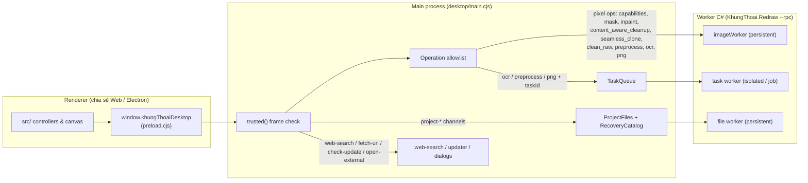
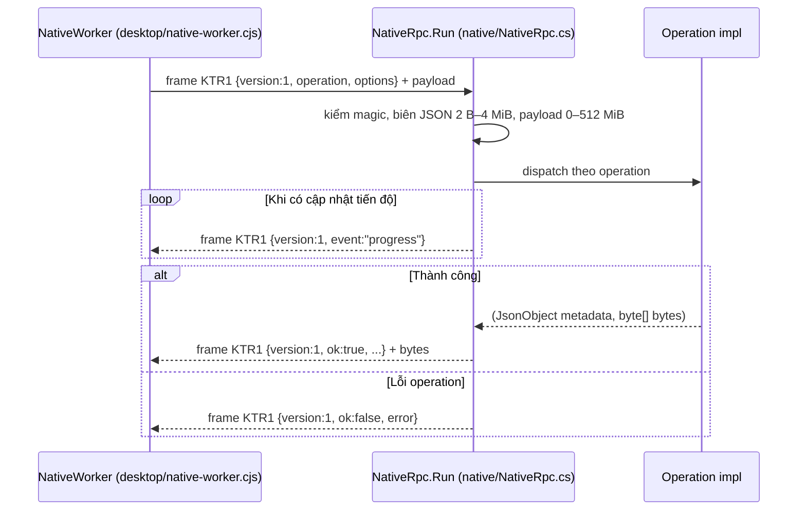
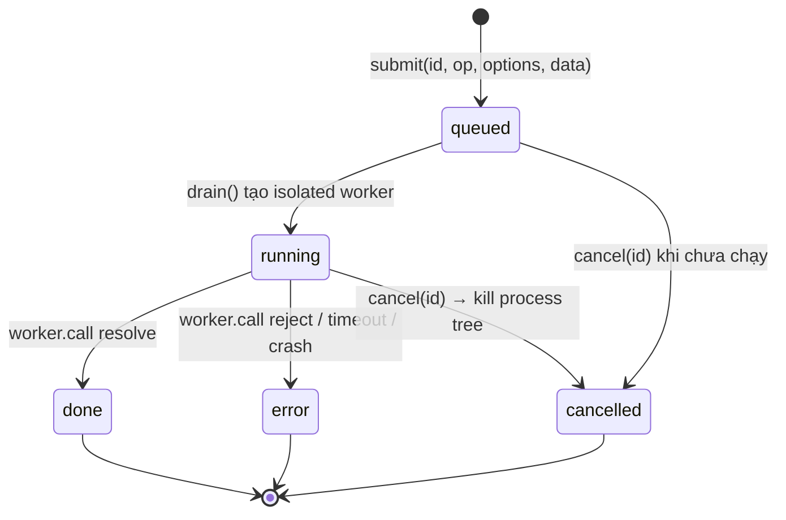
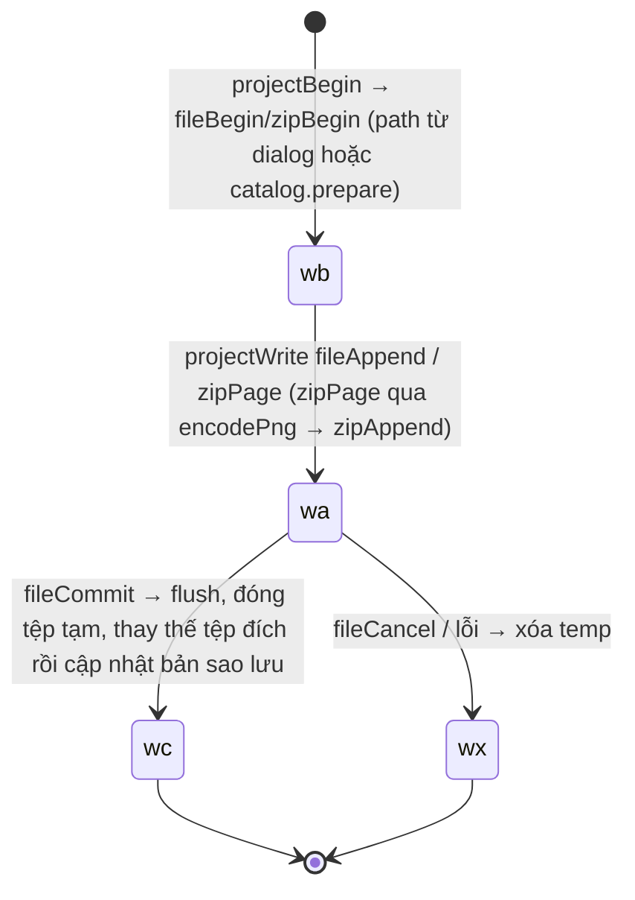
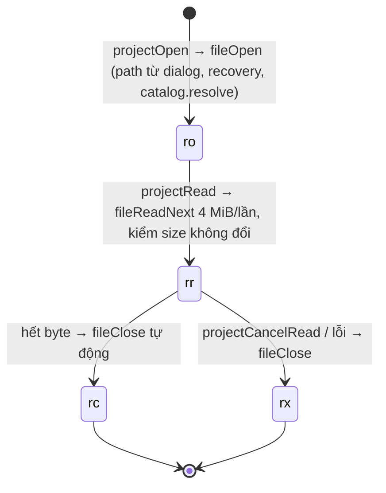
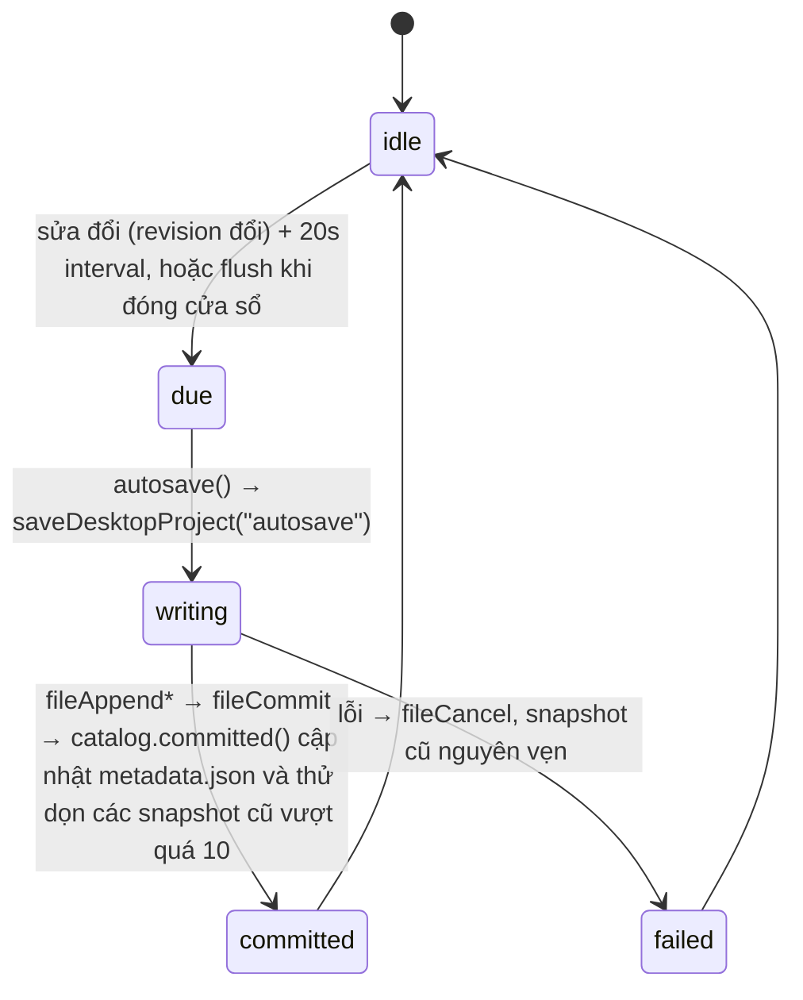

# Kiến trúc hệ thống

Tài liệu này mô tả kiến trúc thực tế của mã nguồn: luồng RPC giữa renderer và worker C#, quy tắc phiên bản giao thức, máy trạng thái tác vụ và phục hồi, ranh giới tin cậy IPC, và cách phân định dữ liệu persist / phiên / danh mục. Các sơ đồ đối chiếu trực tiếp với mã tại thời điểm viết; khi giao thức thay đổi cần cập nhật lại tài liệu này.

Phần mô tả giao thức khung chi tiết từng operation nằm ở [native/README.md](../native/README.md#protocol); hướng dẫn thêm operation mới nằm ở [Extending the worker](../native/README.md#extending-the-worker).

## 1. Sơ đồ tiến trình

- Bản **Web** không có `desktop` (`src/native.js` đọc `globalThis.khungThoaiDesktop`): mọi thao tác ảnh chạy trên Canvas 2D / Web Worker (`src/image-worker.js`), lưu phiên vào IndexedDB, xuất qua JSZip/ag-psd.
- Bản **Desktop** dùng chung renderer đó; `preload.cjs` expose đúng một object `khungThoaiDesktop` với danh sách hàm cố định.
- Main process spawn tối đa ba vai trò worker từ cùng một executable: `worker` (file), `imageWorker` (pixel) và một worker isolated mới cho mỗi tác vụ trong `TaskQueue` — [desktop/main.cjs](../desktop/main.cjs), [desktop/task-queue.cjs](../desktop/task-queue.cjs).

## 2. Khung RPC KTR1

Giao tiếp renderer ↔ C# không đi qua JSON-RPC mà qua frame nhị phân trên stdio của tiến trình con. Mỗi frame (cả request lẫn reply) có cùng bố cục:

| Offset | Kích thước | Trường |
|---:|---:|---|
| 0 | 4 byte | Magic ASCII `KTR1` |
| 4 | 4 byte | uint32 little-endian: số byte metadata JSON |
| 8 | 4 byte | uint32 little-endian: số byte payload nhị phân |
| 12 | N byte | Metadata JSON UTF-8 |
| 12 + N | M byte | Payload nhị phân (có thể rỗng) |

Quy tắc đã kiểm chứng trong mã:

- **Request**: JSON tối đa 4 MiB (`metaLength` trong `[2, 4 MiB]`), payload tối đa 512 MiB (`dataLength` trong `[0, 512 MiB]`). `NativeRpc.Run` đọc từng frame trong vòng lặp và `return 1` ngay khi magic/sai biên — tiến trình thoát, stream đóng. Phía JS, `native-worker.cjs` ghi header 12 byte rồi metadata rồi payload ([desktop/native-worker.cjs:107-121](../desktop/native-worker.cjs)).
- **Metadata request**: `{version, operation: string, options: object, protocol: {min, max}}`; dải không giao nhau với `ProtocolMinimum`/`ProtocolVersion`, hoặc `version` ngoài dải, ném `InvalidDataException("Native protocol incompatible: …")` → reply `ok:false` kèm dải của worker. Phía JS đóng gói dải nó chấp nhận khi enqueue ([desktop/native-worker.cjs:82-87](../desktop/native-worker.cjs)).
- **Reply**: `{version, protocolVersion, minProtocol, maxProtocol, ok: boolean}` cộng metadata operation; `ok:false` kèm `error`. JS chọn version chung nhỏ nhất, lưu nó cho connection và đòi mọi reply sau khai đúng version đó cùng `typeof result.ok === "boolean"`; frame thiếu cả dải lẫn version vẫn bị coi là không hỗ trợ và dừng worker ([desktop/native-worker.cjs:184-199](../desktop/native-worker.cjs)).
- **Progress**: operation dài gọi `NativeProgress.Emit(progress, stage)` ([native/NativeProgress.cs](../native/NativeProgress.cs)); `NativeRpc` gán `Report` trong lúc dispatch và emit frame `{version:1, event:"progress", progress, stage}` với payload rỗng **trước** reply cuối. `Report` được reset về `null` sau mỗi operation. Phía JS, `read()` nhận diện `event === "progress"` và có thể xử lý nhiều frame trong một chunk stdout bằng đệ quy trên phần dư ([desktop/native-worker.cjs:174-182](../desktop/native-worker.cjs)).
- **Lỗi transport vs lỗi operation**: lỗi *operation* (validate options, I/O thất bại…) trả `ok:false` + `error`, stream vẫn đồng bộ và worker tiếp tục phục vụ request sau. Lỗi *framing* (magic sai, count vượt biên, header/body cắt ngắn, JSON hỏng, byte thừa sau reply cuối) khiến client dừng luồng phản hồi hoặc worker thoát khi không đọc được khung yêu cầu. JSON request hỏng trong một khung đọc đủ được trả về dưới dạng `ok:false`. Reply khai dải protocol khác là lỗi *phiên bản*, không phải framing: request đang chờ bị reject bằng `NativeProtocolError` (`code: NATIVE_PROTOCOL_INCOMPATIBLE`), tiến trình giữ nguyên file handle, mọi request sau lỗi ngay trên cùng lỗi đó và chỉ `close()` mới kill worker.
- **Giới hạn phía JS**: mỗi `NativeWorker` từ chối khi `queued >= 8` hoặc `data.byteLength > 512 MiB`; metadata > 4 MiB bị từ chối trước khi ghi ([desktop/native-worker.cjs:72-88](../desktop/native-worker.cjs)). Timeout request: 90 giây cho `ocr`, 120 giây cho các operation còn lại.

### Điểm vào legacy

`Program.cs` không có `--rpc` chạy chế độ cũ: mỗi frame là header 24 byte (6 × uint32 LE: `width, height, left, top, right, bottom`) + `width*height*4` byte RGBA, reply là uint32 độ dài + patch. `TextureWorker` trong [desktop/worker.cjs](../desktop/worker.cjs) là client tương ứng. Desktop hiện luôn truyền `--rpc` qua `NativeWorker` ([desktop/native-worker.cjs:58](../desktop/native-worker.cjs)) nên đường legacy chỉ còn cho chạy executable trực tiếp; `redraw` trên RPC đi qua cùng engine `RedrawEngine`.

## 3. Quy tắc phiên bản

- Cả request lẫn reply đều mang `version` trong metadata JSON; magic `KTR1` định danh framing. Request khai báo dải chấp nhận `protocol: {min, max}`, reply mang `protocolVersion`, `minProtocol`, `maxProtocol`, còn `capabilities` thêm `operationVersions` để renderer phát hiện tính năng thay vì giả định (issue #58). Dải không giao nhau (worker cũ hoặc mới hơn) → một lỗi ổn định `NativeProtocolError` (`code: NATIVE_PROTOCOL_INCOMPATIBLE`) nêu cả hai dải; tiến trình **không** bị kill vì nó giữ file handle dự án, request sau lỗi ngay trên cùng lỗi đó, và renderer fallback về đường JS. Chỉ frame hỏng mới kết thúc tiến trình.
- Đổi framing không tương thích (layout header, ngữ nghĩa field) yêu cầu bump dải protocol ở cả hai đầu ([native/NativeRpc.cs](../native/NativeRpc.cs), [src/native.js](../src/native.js), [desktop/native-worker.cjs](../desktop/native-worker.cjs)) và cập nhật `desktop/worker.cjs` nếu legacy bị ảnh hưởng.
- Thêm operation mới **không** đổi version: operation lạ rơi vào `ProjectStorage.Execute` → `InvalidDataException("Unknown native operation")` → `ok:false`, và renderer bị chặn sớm hơn bởi allowlist ở main process.
- Field mới trong `options`/reply phải optional và validate ở operation tương ứng; field project (`.khungthoai`) validate tập trung ở `src/project.js`.

## 4. Máy trạng thái

### 4.1 Tác vụ nền (TaskQueue)

Chỉ `ocr`, `preprocess`, `png` đi qua hàng đợi khi renderer truyền `taskId` ([desktop/main.cjs:101-104](../desktop/main.cjs)); mỗi job chạy trên một worker isolated riêng, bị kill cả cây tiến trình khi hủy ([desktop/task-queue.cjs:52-63](../desktop/task-queue.cjs), [desktop/native-worker.cjs:125-141](../desktop/native-worker.cjs)).

- `id` phải khớp `/^[a-zA-Z0-9-]{1,80}$/`, không trùng, tối đa 16 job trong `jobs` ([desktop/task-queue.cjs:11-14](../desktop/task-queue.cjs)).
- Mỗi chuyển trạng thái `emit` một update `{id, operation, state, progress, stage}` về renderer qua `khung-thoai:task`; `progress` bị kẹp đơn điệu trong `[0,100]`. Renderer giữ 10 tác vụ gần nhất và chỉ hiện nút Hủy ở `queued`/`running` ([src/controllers/tasks.js](../src/controllers/tasks.js)).
- `close()` (will-quit, điều hướng main frame) hủy toàn bộ job; `did-start-navigation` cũng đóng queue và `cancelAll()` các phiên file ([desktop/main.cjs:72](../desktop/main.cjs)).

### 4.2 Phiên ghi / đọc / xuất file (ProjectFiles + ProjectStorage)

API truyền file không trả về đường dẫn hay handle native. Renderer nhận `id` UUID phiên do main cấp, main giữ map sang `nativeId` handle trong `ProjectStorage` ([desktop/project-files.cjs](../desktop/project-files.cjs), [native/ProjectStorage.cs](../native/ProjectStorage.cs)).

- `projectWrite` chỉ chấp nhận operation trong allowlist theo mode: zip → `zipPage|fileCommit|fileCancel`, còn lại → `fileAppend|fileCommit|fileCancel`; `fileCommit`/`fileCancel` đóng phiên và dọn map ([desktop/project-files.cjs:78-97](../desktop/project-files.cjs)).
- `fileBegin`/`zipBegin` ghi vào `path.<guid>.tmp` cùng thư mục đích; `fileCommit` flush và đóng tệp tạm, kiểm tra ZIP nếu có, chuẩn bị bản sao của tệp dự án cũ, rồi thay thế tệp đích bằng `File.Move` hoặc `File.Replace`. Bản sao `.bak` được công bố sau khi tệp chính đã thay thế thành công. Nếu cập nhật bản sao thất bại, worker giữ bản sao trước đó ([native/ProjectStorage.cs:81-99](../native/ProjectStorage.cs)).
- ZIP giới hạn 50 trang, tên phải là `*.png` an toàn; `zipPage` được main chuyển thành `zipAppend` sau khi `encodePng` (tác vụ `png` qua TaskQueue) ([native/ProjectStorage.cs:65-80](../native/ProjectStorage.cs), [desktop/project-files.cjs:83-87](../desktop/project-files.cjs)).

### 4.3 Vòng đời snapshot phục hồi

- Mỗi lần hoàn tất ghi đều được đối chiếu với **ảnh chụp phiên** `{projectId, generation, revision}`; chỉ khi `projectId` và `generation` còn trùng thì `savedRevision`/`lastWebSnapshot` mới được cập nhật. `generation` tăng mỗi lần thay phiên biên tập (mở tệp, mở bản phục hồi, dự án mới), nên một lần ghi hoàn tất muộn không thể đánh dấu phiên kế tiếp là đã lưu; lần ghi cũ vẫn giữ nguyên bản của nó và một lần ghi mới được xếp ngay cho thế hệ mới ([src/controllers/project.js](../src/controllers/project.js)).
- Desktop: `autosave()` chạy mỗi 20 giây khi `nativeReady` và không busy/gesture, bỏ qua khi thay đổi hiện tại đã nằm trong tệp hoặc một bản tự lưu native. Khi đóng app, renderer cam kết `commitLiveForm` trước, chờ các lần ghi đang chạy có giới hạn thời gian, ưu tiên `autosave()` qua worker, rồi đến bản tự lưu trình duyệt dự phòng. Nhánh dự phòng chỉ tính là bền vững khi bản ghi đúng `{projectId, generation, revision}` đọc lại được từ IndexedDB (`webSnapshotAvailable`); nếu người dùng sửa tiếp trong lúc ghi, bản mới nhất được ghi lại thay vì chấp nhận bản cũ. Cửa sổ chỉ đóng khi thay đổi đã bền vững hoặc người dùng xác nhận bỏ; sự kiện đóng lặp lại được gộp bằng cờ `closing`, bị hủy nếu đang có tác vụ chạy, và một lần lưu tay quá hạn chờ không bị await vô hạn.
- Lưu dự án thủ công chỉ ghi tệp: nó không xóa bản tự lưu trình duyệt của chính tab này hay của tab khác. Trong shell desktop, thao tác tải tệp (`saveFile`) không được coi là bằng chứng đã lưu vì hộp thoại lưu có thể bị hủy; nhãn **Còn thay đổi chưa lưu** và quyết định đóng vẫn dựa trên bản ghi bền vững.
- Snapshot autosave đặt tại `userData/projects/<projectId>/<timestamp>-<uuid>.khungthoai` do `RecoveryCatalog.prepare` cấp; `committed()` ghi `metadata.json` qua file tạm + rename và xóa snapshot vượt quá 10 ([desktop/recovery-catalog.cjs:41-62](../desktop/recovery-catalog.cjs)).
- Đọc snapshot cũ đi qua `catalog.resolve(projectId, snapshotId)` — ID snapshot phải khớp pattern chặt, không nhận path tự do ([desktop/recovery-catalog.cjs:73-81](../desktop/recovery-catalog.cjs)).
- Web (và desktop chưa có worker): cùng nhịp 20 giây nhưng ghi snapshot IndexedDB (`saveWebSnapshot`), không qua worker. Khóa gồm `snapshot:<savedAt>:<projectId>:<writer>:<epoch>` cho blob và `meta:` cùng hậu tố cho bản ghi nhẹ. **Mỗi page instance sở hữu một slot**: một lần ghi thay đúng slot của nó theo epoch. Các lần tải lại và các tab nhân bản có epoch riêng, kể cả khi dùng cùng writer trong `sessionStorage`. Toàn bộ việc quét khóa, quyết định và ghi/xóa diễn ra trong **một transaction readwrite**, nên hai tab không thể chen giữa. Giới hạn 8 bản tổng và 3 bản mỗi dự án chỉ chặn session mới: khi không còn chỗ an toàn, lần ghi bị từ chối (`capacity`/`project-capacity`), các bản đã lưu giữ nguyên và phiên khởi tạo vẫn ở trạng thái chưa lưu. Bản ghi `latest` của phiên bản cũ được chuyển vào khóa mới trong cùng transaction rồi xóa, không bị dọn để lấy chỗ; bản ghi của bản nháp trước đó (khóa không có `epoch`) vẫn đọc được và được tính vào giới hạn; `fonts` không bị chạm. `onversionchange` đóng kết nối và mở lại khi tab khác nâng cấp schema, `onblocked` trả lý do `blocked` để UI hướng dẫn đóng tab cũ; `BroadcastChannel` chỉ để làm mới danh sách, không phải điều kiện đúng đắn — trước khi đóng, controller đọc lại đúng bản ghi thay vì tin thông báo.

## 5. Ranh giới tin cậy IPC

Mô tả theo hướng phòng thủ: mỗi hàng là một điểm mà dữ liệu vượt ranh giới, kèm kiểm soát thực tế trong mã.

| Ranh giới | Kiểm soát thực tế |
|---|---|
| Renderer → preload | `contextIsolation: true`, `sandbox: true`, `nodeIntegration: false`, `webviewTag: false` ([desktop/main.cjs:62-68](../desktop/main.cjs)). `contextBridge` chỉ expose `khungThoaiDesktop` với hàm cố định; không lộ `ipcRenderer` thô ([desktop/preload.cjs](../desktop/preload.cjs)). |
| Preload → main (IPC) | Mọi handler `ipcMain.handle` đều bọc bởi `trusted()`: `event.sender === mainWindow.webContents`, `senderFrame` không có parent, và `senderFrame.url` (bỏ fragment) đúng bằng `app://khung-thoai/index.html`. Frame lạ nhận `{error: "Untrusted desktop frame."}` ([desktop/main.cjs:93-99](../desktop/main.cjs)). |
| Điều hướng & cửa sổ | `setWindowOpenHandler` deny, `will-navigate` prevent, `will-attach-webview` prevent; `did-start-navigation` chỉ dọn dẹp khi là main frame, **không** in-place và URL khác entry — chuyển giữa `#editor`/`#library` giữ nguyên TaskQueue và phiên file, còn điều hướng thật đóng queue, hủy phiên file và `cancelAll()` các lượt provider ([desktop/main.cjs](../desktop/main.cjs)). CSP chặt qua header trên scheme `app` ([desktop/main.cjs:13-21](../desktop/main.cjs)). |
| Static assets | `localFile()` chỉ phục vụ file nằm dưới `dist/` sau `path.resolve` + kiểm `path.relative` — chặn path traversal ([desktop/main.cjs:43-50](../desktop/main.cjs)). Quyền permission (camera, notification…) bị deny toàn bộ. |
| Renderer → native op | Allowlist cứng trong `khung-thoai:native`: `capabilities, mask, inpaint, content_aware_cleanup, seamless_clone, clean_raw, preprocess, ocr, png` — `redraw` đi kênh riêng `redraw-texture`, file ops không bao giờ lộ ra renderer ([desktop/main.cjs:100-105](../desktop/main.cjs)). |
| Renderer → kho khóa của OS | Chỉ ba kênh `credential-status`, `credential-save`, `credential-remove`; không có kênh đọc, liệt kê hay xuất. Scope được main suy ra từ cặp `provider`/`endpoint` do chính main canonical hóa (HTTPS, hoặc HTTP với loopback literal; từ chối userinfo/query/fragment), renderer chỉ nhận handle băm 31 ký tự. Mọi lỗi được thay bằng chuỗi cố định nên cause native, stack hay path không tới renderer ([desktop/credential-ipc.cjs](../desktop/credential-ipc.cjs)). Ciphertext nằm ở `userData/credentials/<handle>` (file 0600, thư mục 0700) và chỉ được coi là đã bảo vệ khi tag của safeStorage chứng minh provider của OS — `v10` DPAPI/Keychain, `v11` Secret Service, `v12` portal; tag lạ bị từ chối thay vì tin ([desktop/credential-store.cjs](../desktop/credential-store.cjs)). |
| Renderer → provider | `provider-request`, `provider-stream`, `provider-activate`, `provider-cancel` chỉ nhận `provider`, `operation`, `model`, `payload`, `endpoint` (chỉ với OpenAI-compatible) và `timeoutMs` đã kiểm biên. Main tự dựng URL từ scope canonical, đọc khóa từ kho, ghim đúng IP đã phân giải, áp hạn chót cho cả lượt, và redact mọi dạng phản chiếu của khóa (literal, base64, base64url, URL-encode) trước khi body tới renderer ([desktop/provider-transport.cjs](../desktop/provider-transport.cjs), [src/provider-bridge.js](../src/provider-bridge.js)). |
| Renderer → filesystem | Không có kênh trực tiếp. `project-*` channels nhận `id` phiên UUID; path chỉ đến từ `dialog.showOpenDialog/showSaveDialog`, `recovery.khungthoai` cố định, hoặc `RecoveryCatalog` dưới `userData`. `projectBegin` kiểm mode ở main và `ProjectFiles.begin` kiểm `validId(projectId)` ([desktop/main.cjs:115-119](../desktop/main.cjs), [desktop/project-files.cjs](../desktop/project-files.cjs)). |
| Main → worker C# | Spawn process con với `stdio: ["pipe","pipe","ignore"]`, args cố định `--rpc`, `windowsHide`, không shell; isolated task worker `detached` để kill cả process group ([desktop/worker.cjs:46-53](../desktop/worker.cjs), [desktop/native-worker.cjs:58](../desktop/native-worker.cjs)). Worker chỉ thấy bytes trên stdin — Các lệnh I/O dự án do `ProjectStorage` xử lý với đường dẫn do main cấp. OCR cũng có thể chạy Tesseract như tiến trình con. |
| Worker → filesystem | `ProjectStorage` chỉ thao tác trên `options.path`/`options.id` do main truyền; commit qua temp + move atomic cùng thư mục; reader mở `FileShare.ReadWrite \| Delete` để atomic replace không làm hỏng phiên đọc ([native/ProjectStorage.cs:29-35](../native/ProjectStorage.cs), [native/ProjectStorage.cs:113-121](../native/ProjectStorage.cs)). |
| Mạng | `connect-src` giới hạn `self` + HTTPS + loopback; `web-search.cjs` cố định IP đã phân giải cho kết nối và giới hạn dữ liệu giải nén; `open-external` chỉ mở HTTPS public đã validate ([desktop/web-search.cjs](../desktop/web-search.cjs), [desktop/main.cjs:129-134](../desktop/main.cjs)). |

## 6. Phân định dữ liệu

| Loại | Nơi sở hữu | Định dạng / vòng đời |
|---|---|---|
| Dữ liệu dự án persist | File `.khungthoai` do `ProjectStorage` ghi atomic; nội dung do renderer dựng | Blob `KHUNGTHOAI\n` + uint32 độ dài manifest + JSON manifest ≤16 MiB (`version: 2`, thêm `version: 3` khi có bộ nhớ dịch, `version: 4` khi trang có layer stack riêng hoặc có quyết định QA, đọc được `version: 1`–`4`) + bytes ảnh từng trang; validate từng field ở `src/project.js`, sai cấu trúc → `invalidProject()`. Stack mặc định không được ghi xuống, nên dự án chưa đụng tới lớp vẫn mở được ở bản cũ. |
| Catalog & snapshot phục hồi | `RecoveryCatalog` trong main process sở hữu `userData/projects/<id>/` và `metadata.json` | Tối đa 10 snapshot `.khungthoai` mỗi `projectId` + bản legacy `recovery.khungthoai[.bak]`; path không bao giờ do renderer tự chọn. |
| Trạng thái phiên renderer | `EditHistory` (Undo/Redo ≤40) và DOM/canvas | Lịch sử chỉ sống trong bộ nhớ renderer; mỗi checkpoint có id, tên hành động, thời điểm và nhóm, nên panel lịch sử nhảy tới đúng mốc trước một hành động mà vẫn giữ được thứ tự redo (`Ctrl+Shift+H`). Tệp dự án lưu trạng thái chỉnh sửa hiện tại và `translationJob`; job đang chạy được lưu ở trạng thái chờ. Ảnh/File dùng chung tham chiếu, chỉ dữ liệu editable bị clone ([src/history.js](../src/history.js)). |
| Khóa API | `CredentialStore` trong main process, thư mục `userData/credentials/` | Ciphertext của `safeStorage` theo handle; plaintext chỉ sống trong biến cục bộ của main đúng lúc gọi provider, không cache lại. Cấu hình AI cũ được migrate một lần qua `migrateLegacyCredentials`: khóa chỉ bị xóa khỏi localStorage sau khi đã nằm trong kho, và giữ nguyên khi kho chưa mở (`MIGRATION_DEFERRED`) ([src/credential-settings.js](../src/credential-settings.js)). |
| Fallback trình duyệt | IndexedDB (`src/web-storage.js`) + Canvas/JSZip/inpaint JS | Cùng nhịp autosave 20s; không có worker C#, không có filesystem — `desktop` là `undefined` nên mọi nhánh `desktop?.` tự tắt. Store `snapshots` chứa cặp bản ghi blob + meta theo khóa `snapshot:`/`meta:` (schema 2, dùng chung DB v2 nên không cần nâng cấp khi migrate `latest`). Mỗi page instance một slot, thay slot của chính nó; giới hạn 8 bản tổng và 3 bản/dự án chỉ từ chối session mới, không dọn bản của session khác. |

## 7. Checklist thêm một operation

Tổng hợp từ [Extending the worker](../native/README.md#extending-the-worker) và các điểm đăng ký thực tế trong mã. Giả sử operation mới tên `dichVuX`.

1. **Quyết định phạm vi quyền.** Operation có chạm filesystem không? Không → có thể thêm vào allowlist sau khi kiểm tra phạm vi quyền. Có → bắt buộc đi qua `ProjectFiles`/`ProjectStorage`, renderer chỉ thấy `project-*` channels và handle UUID — không thêm vào allowlist `khung-thoai:native`.
2. **Cài đặt C# trong file riêng** (ví dụ `native/DichVuX.cs`): hàm nhận `(JsonObject options, byte[] data)` và trả `(JsonObject metadata, byte[] bytes)`; validate `options` (dimension ảnh qua `NativeImaging.Dimensions`, enum, range); gọi `NativeProgress.Emit` nếu chạy lâu; ném exception cho lỗi operation — `NativeRpc` tự gói `ok:false`.
3. **Đăng ký dispatch** trong `NativeRpc.Run` ([native/NativeRpc.cs:65-77](../native/NativeRpc.cs)): thêm `"dichVuX" => DichVuX.Execute(options, data)` vào switch. Operation file thì thêm `case` trong `ProjectStorage.Execute` thay vì switch chính.
4. **Khai báo capability**: thêm category vào mảng `operations` trong `LocalOcr.Capabilities` ([native/LocalOcr.cs:43-66](../native/LocalOcr.cs)) nếu renderer cần phát hiện qua `nativeCapabilities()`; `operations` và `operationVersions` sinh từ `NativeRpc.Operations`, nên thêm operation không đổi `ProtocolVersion` trừ khi đổi framing.
5. **Expose qua main process**: thêm `"dichVuX"` vào allowlist ở `handle("khung-thoai:native")` ([desktop/main.cjs:102](../desktop/main.cjs)). Nếu operation dài, đưa vào nhóm `["ocr","preprocess","png"]` để renderer truyền `taskId` chạy trên worker isolated.
6. **Gọi từ renderer** qua `src/native.js`: `desktop.native("dichVuX", options, data)` cho tác vụ ngắn, `runNativeTask(...)` khi cần hàng đợi/tiến độ/hủy. Không truyền path, handle hay URL file.
7. **Giữ giao thức**: metadata request vẫn `{version, operation, options, protocol: {min, max}}`; payload ≤512 MiB, JSON ≤4 MiB; không thêm field bắt buộc phá tương thích; chỉ bump dải protocol khi đổi framing.
8. **Test theo native/README**: error recovery (operation lỗi không làm mất đồng bộ stream), biên (0/512 MiB, ảnh méo), alpha compositing nếu liên quan pixel, và cancellation nếu đi qua TaskQueue — xem `test/native-framing.test.js`, `test/task-queue.test.js`, `test/recovery-catalog.test.js`.
9. **Cập nhật tài liệu**: thêm operation vào danh sách protocol trong `native/README.md` và sơ đồ §1 của tài liệu này nếu thêm vai trò worker/kênh IPC mới.

## 8. Walkthrough (docs-only): operation giả định `inkBounds`

Ví dụ minh họa checklist trên với một operation **không đụng filesystem**: nhận RGBA + options, trả JSON các bounding box vùng mực, payload rỗng. Không có mã nào được thêm — walkthrough này chỉ đối chiếu từng bước với mã hiện tại.

| Bước | Việc sẽ làm | Đối chiếu mã hiện tại |
|---|---|---|
| 1. Phạm vi | `inkBounds` thuần tính toán → có thể được expose renderer sau khi kiểm tra phạm vi quyền; không đụng `ProjectFiles`. | Renderer đã gọi op pixel trực tiếp qua `desktop.native` ([src/retouch.js:321](../src/retouch.js)); file op mới là thứ bị cấm ([desktop/main.cjs:102](../desktop/main.cjs)). |
| 2. C# | `native/InkBounds.cs` mới; `Execute(options, data)` validate `width/height` qua `NativeImaging.Dimensions`, duyệt pixel tìm bounding box, trả `(JsonObject{boxes:[...]}, [])`. | Dispatch bọc kết quả `NativeImaging.Mask` thành `(JsonObject, byte[])` tại [native/NativeRpc.cs:41](../native/NativeRpc.cs); lỗi ném `InvalidDataException` như `Redraw` ở [native/NativeRpc.cs:79-84](../native/NativeRpc.cs). |
| 3. Dispatch | Thêm `"inkBounds" => InkBounds.Execute(options, data)` vào switch trước nhánh `_ => storage.Execute(...)`. | Switch tại [native/NativeRpc.cs:65-77](../native/NativeRpc.cs); op lạ hiện rơi vào storage và trả `Unknown native operation`. |
| 4. Capability | Thêm `"inkBounds"` vào `NativeRpc.Operations`; dải protocol giữ nguyên. | [native/LocalOcr.cs:43-66](../native/LocalOcr.cs); renderer đọc qua `nativeCapabilities()` ở [src/native.js:86-90](../src/native.js). |
| 5. Main | Thêm `"inkBounds"` vào mảng allowlist; nếu tính cả chương thì đưa vào nhóm task để có `taskId`. | Allowlist [desktop/main.cjs:102](../desktop/main.cjs); nhóm task `["ocr","preprocess","png"]` cùng dòng; `tasks.submit` validate id qua regex ở [desktop/task-queue.cjs:11](../desktop/task-queue.cjs). |
| 6. Renderer | Gọi `desktop.native("inkBounds", {width,height}, pixels)` hoặc `runNativeTask` nếu qua queue; vẽ kết quả lên canvas như `runNativeTask("png", …)` ở [src/canvas.js:463-465](../src/canvas.js). | Reply `{result, data}` được `preload` mở gói `{value}`/`{error}` ([desktop/preload.cjs:3-7](../desktop/preload.cjs)). |
| 7. Giao thức | Request `{version:1, operation:"inkBounds", options, protocol:{min:1,max:1}}` + payload RGBA; reply mang `protocolVersion`/`minProtocol`/`maxProtocol` = 1 cùng `ok:true, boxes:[…]` payload rỗng; lỗi → `ok:false`. Không bump dải protocol. | Khung và giới hạn ở §2; `NativeProgress.Emit` chỉ cần nếu op phát progress frame ([native/NativeProgress.cs](../native/NativeProgress.cs)). |
| 8. Test | Case mới trong `test/native-framing.test.js` style (reply `ok:true` metadata-only) + test operation trong `test/` Node runner; case hủy nếu qua TaskQueue. | `CASE_BUDGET`/seeded generator tại [test/native-framing.test.js](../test/native-framing.test.js); queue tests ở `test/task-queue.test.js`. |
| 9. Docs | Thêm bullet `inkBounds` vào protocol list trong `native/README.md`; sơ đồ §1 đã đủ vì không thêm vai trò/kênh mới. | Danh sách protocol [native/README.md:21-29](../native/README.md). |

Kết quả mong đợi nếu triển khai thật: renderer gọi `inkBounds` → main kiểm `trusted()` + allowlist → `imageWorker.call` (hoặc `TaskQueue` nếu truyền `taskId`) → frame KTR1 → C# dispatch → reply metadata-only → JS resolve `{result:{version:1, ok:true, boxes}, data:empty}` — không chạm `ProjectFiles`, không path nào lộ ra renderer.
